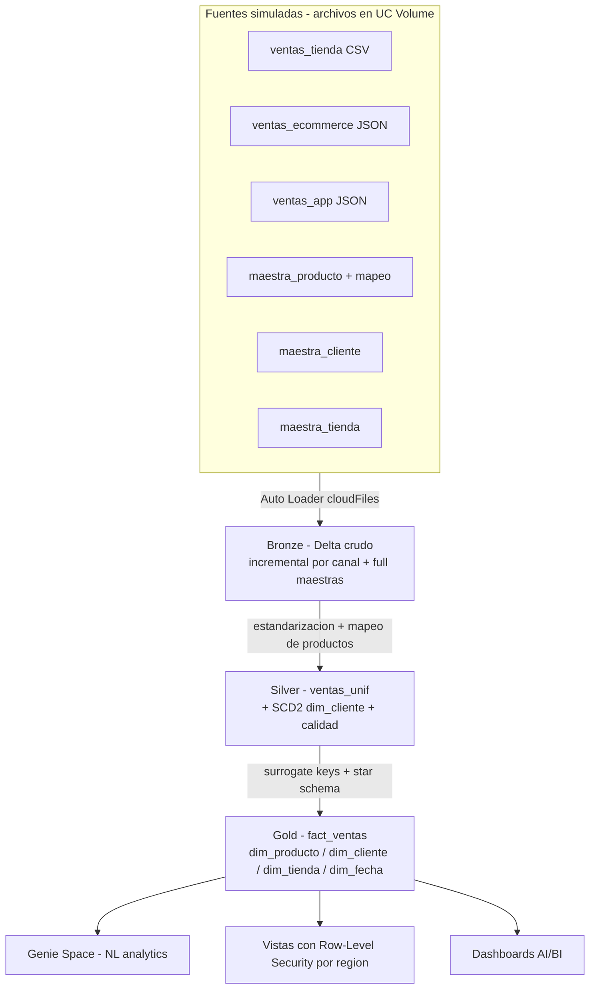
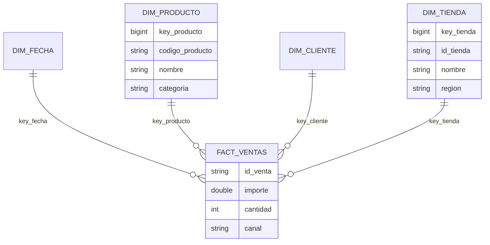

# Ejercicio 1 — Pipeline End-to-End con Arquitectura Medallion en Databricks

### Ingesta batch + incremental · Integración · Modelo analítico · Genie + RLS

> **Stack:** Databricks Free Edition · Unity Catalog · Auto Loader · Delta Lake · PySpark/Spark SQL · Databricks Workflows · Asset Bundles · AI/BI Genie
> **Construido con:** Claude Code + AI Dev Kit (asistente de IA para escribir y depurar el código en vivo)
> **Nivel:** Junior → Semi-senior (Data Engineer) · **Tiempo:** ~3-4 h
> **Corre 100% en Databricks Free Edition** (serverless, sin tarjeta). El `$200 trial` no es necesario.

---

## 1. Contexto de negocio

### 1.1 La empresa — Tambo Andino S.A.C. (caso ficticio)

**Tambo Andino** es una cadena de tiendas de conveniencia que vende los mismos productos a través de **tres canales de venta independientes**, cada uno con su propio sistema transaccional:

| Canal | Sistema | Nomenclatura de productos | Volumen diario |
|---|---|---|---|
| Tienda física | POS legacy | `P001`, `P002`, `P003`… | ~1.500 ventas |
| E-commerce | Plataforma web | `quinua-1kg`, `cafe-organico-250g`… | ~900 ventas |
| App móvil | App propia | `Quinua Orgánica 1kg`, `Café Orgánico 250g`… | ~600 ventas |

### 1.2 El problema central: datos inconsistentes

Los tres sistemas venden los **MISMOS productos**, pero los nombran de forma **completamente distinta**. Esto hace imposible generar reportes consolidados sin transformación.

> ⚠️ **Este es el problema más común en proyectos reales de Data Engineering:** múltiples sistemas de origen que representan la misma realidad con nomenclaturas distintas.

| Producto real | POS (físico) | E-commerce | App móvil |
|---|---|---|---|
| Quinua Orgánica 1kg | `P001` | `quinua-1kg` | `Quinua Orgánica 1kg` |
| Café Orgánico 250g | `P002` | `cafe-organico-250g` | `Café Orgánico 250g` |
| Cacao en Polvo 500g | `P003` | `cacao-polvo-500g` | `Cacao en Polvo 500g` |
| Miel de Abeja 500g | `P004` | `miel-500g` | `Miel de Abeja 500g` |
| Aguaymanto Deshidratado | `P005` | `aguaymanto-deshid` | `Aguaymanto Deshidratado` |

### 1.3 Objetivo de la plataforma

Construir una **plataforma de datos moderna en Databricks** que permita:

- Ingestar datos diariamente desde los tres canales (cargas **batch** + **incrementales**).
- **Unificar y estandarizar** los datos en una única fuente de verdad.
- Construir un **Data Mart analítico con modelo estrella** (star schema).
- Exponer la analítica con **AI/BI Genie** (preguntas en lenguaje natural) y **Row-Level Security** (cada gerente regional ve solo su región).
- Ejecutar todo de forma **automatizada** (Workflow diario) y **versionada** (git + Asset Bundles).

> 🔀 **Nota para el taller:** las secciones 4-7 (RAW→Gold) son el **track Data Engineer**. La sección 8 (Genie + RLS sobre el Gold) es donde empieza el **track Data Analyst** — el DA puede tomar el Gold ya construido y trabajar de ahí.

---

## 2. Arquitectura del proyecto

### 2.1 Diagrama de arquitectura



### 2.2 Decisiones de diseño

| Decisión | Tecnología elegida | Justificación |
|---|---|---|
| Ingesta de archivos | **Auto Loader** (`cloudFiles`) | Detección incremental de archivos nuevos + evolución de esquema, sin re-leer todo |
| Formato de todas las capas | **Delta Lake** | Transacciones ACID, time travel, `MERGE`, schema enforcement |
| Motor de transformación | **PySpark / Spark SQL** | Procesamiento distribuido nativo en Databricks |
| Gobierno y organización | **Unity Catalog** (catalog → schema → table/volume) | Permisos, linaje, RLS y separación lógica de capas |
| Orquestación | **Databricks Workflows** (Job) | Scheduling + dependencias + reintentos, sin código extra |
| Particionado Bronze ventas | `fecha_particion` | Optimiza lecturas incrementales |
| Optimización Gold | `OPTIMIZE` + `ZORDER` + `VACUUM` | Compactación, data-skipping y limpieza de archivos |
| Seguridad analítica | **Row Filters** (UC) por región | Cada gerente ve solo las ventas de su región |
| Despliegue | **Databricks Asset Bundles (DABs)** | Promoción dev→prod versionada con un solo comando |

### 2.3 Estructura en Unity Catalog

```
tambo_andino                      (CATALOG)
├── 00_landing                    (SCHEMA)  -> Volume con archivos crudos
│   └── raw                       (VOLUME)
│       ├── ventas_tienda/        fecha_particion=YYYY-MM-DD/*.csv
│       ├── ventas_ecommerce/     fecha_particion=YYYY-MM-DD/*.json
│       ├── ventas_app/           fecha_particion=YYYY-MM-DD/*.json
│       └── maestras/             producto.csv · cliente.csv · tienda.csv · mapeo_producto.csv
├── 01_bronze                     (SCHEMA)  -> Delta crudo, sin transformar
├── 02_silver                     (SCHEMA)  -> integrado y estandarizado
└── 03_gold                       (SCHEMA)  -> modelo estrella (Data Mart)
```

> 💡 **Costos / ambientación:** en producción cada capa puede vivir en un *storage* (External Location) distinto y con tiers diferenciados (raw en frío, gold en caliente). En Free Edition usamos un solo catalog; en la sección 11 simulamos entornos `dev`/`prod` con DABs.

---

## 3. Setup del entorno

### 3.1 Requisitos

1. **Cuenta Databricks Free Edition** — registrarse en `databricks.com/learn/free-edition` (gratis, sin tarjeta). Serverless + Unity Catalog + Delta incluidos.
2. **Cuenta GitHub** — para versionar el repo (tu portafolio).
3. **Claude Code** instalado localmente (o usar el asistente de IA del workspace) — será el copiloto para escribir y depurar el código.

### 3.2 Inicializar el repo (tu portafolio)

```bash
# Local, con Claude Code abierto en la carpeta
git init -b main
mkdir -p src/{00_setup,01_bronze,02_silver,03_gold,04_consumo} resources
# Pedile a Claude Code: "creá un README explicando este pipeline medallion de Tambo Andino"
git add -A && git commit -m "scaffold: medallion pipeline Tambo Andino"
```

### 3.3 Importar el repo en Databricks

En Databricks: **Workspace → Repos → Add Repo** → pegar la URL de GitHub → branch `main`. El repo aparece como carpeta editable en el workspace.

### 3.4 Crear catálogo, schemas y volume

`src/00_setup/00_environment_setup.sql` (correr en un notebook SQL):

```sql
CREATE CATALOG IF NOT EXISTS tambo_andino;
USE CATALOG tambo_andino;

CREATE SCHEMA IF NOT EXISTS `00_landing`;
CREATE SCHEMA IF NOT EXISTS `01_bronze`;
CREATE SCHEMA IF NOT EXISTS `02_silver`;
CREATE SCHEMA IF NOT EXISTS `03_gold`;

CREATE VOLUME IF NOT EXISTS `00_landing`.raw;
```

---

## 4. Capa RAW — generación de datos sintéticos

No tenemos sistemas reales, así que **generamos datos sintéticos** que reproducen el caos de las 3 fuentes. Esto también te enseña a crear datos de prueba (algo muy útil en entrevistas).

`src/00_setup/01_data_generator.py` (notebook PySpark):

```python
# Databricks notebook — generador de datos sintéticos para Tambo Andino
from pyspark.sql import functions as F
import random, datetime

CATALOG = "tambo_andino"
VOL = f"/Volumes/{CATALOG}/00_landing/raw"
HOY = "2026-06-19"                       # fecha de la corrida (parametrizable)
AYER = "2026-06-18"

# --- catálogo real de productos (la "verdad") ---
productos = [
    ("PROD-01", "Quinua Orgánica 1kg",      "Abarrotes", 18.50),
    ("PROD-02", "Café Orgánico 250g",       "Bebidas",   24.90),
    ("PROD-03", "Cacao en Polvo 500g",      "Abarrotes", 21.00),
    ("PROD-04", "Miel de Abeja 500g",       "Abarrotes", 19.90),
    ("PROD-05", "Aguaymanto Deshidratado",  "Snacks",    15.00),
]
# --- diccionario de nomenclaturas por canal (el "dolor") ---
mapeo = [
    # (codigo_origen, canal, codigo_estandar)
    ("P001","TIENDA","PROD-01"), ("quinua-1kg","ECOMMERCE","PROD-01"), ("Quinua Orgánica 1kg","APP","PROD-01"),
    ("P002","TIENDA","PROD-02"), ("cafe-organico-250g","ECOMMERCE","PROD-02"), ("Café Orgánico 250g","APP","PROD-02"),
    ("P003","TIENDA","PROD-03"), ("cacao-polvo-500g","ECOMMERCE","PROD-03"), ("Cacao en Polvo 500g","APP","PROD-03"),
    ("P004","TIENDA","PROD-04"), ("miel-500g","ECOMMERCE","PROD-04"), ("Miel de Abeja 500g","APP","PROD-04"),
    ("P005","TIENDA","PROD-05"), ("aguaymanto-deshid","ECOMMERCE","PROD-05"), ("Aguaymanto Deshidratado","APP","PROD-05"),
]
# --- tiendas (con región, clave para el RLS) ---
tiendas = [
    ("T01","Tambo Miraflores","Lima"), ("T02","Tambo San Isidro","Lima"),
    ("T03","Tambo Arequipa Centro","Arequipa"), ("T04","Tambo Cusco Plaza","Cusco"),
]
codigos_por_canal = {
    "TIENDA":   [m[0] for m in mapeo if m[1]=="TIENDA"],
    "ECOMMERCE":[m[0] for m in mapeo if m[1]=="ECOMMERCE"],
    "APP":      [m[0] for m in mapeo if m[1]=="APP"],
}
precio = {p[0]: p[3] for p in productos}
est_de = {(m[0],m[1]): m[2] for m in mapeo}

def ventas(canal, fecha, n):
    rows=[]
    for i in range(n):
        cod = random.choice(codigos_por_canal[canal])
        prod_real = est_de[(cod,canal)]
        rows.append((
            f"{canal[:3]}-{fecha}-{i:05d}", fecha, cod,
            round(precio[prod_real]*random.randint(1,4),2), random.randint(1,4),
            f"C{random.randint(1,200):04d}", random.choice([t[0] for t in tiendas]),
            f"{fecha} {random.randint(8,22):02d}:{random.randint(0,59):02d}:00"
        ))
    return rows

cols = ["id_venta","fecha_venta","cod_producto","importe","cantidad","id_cliente","id_tienda","fecha_actualizacion"]

# Generar AYER y HOY para demostrar la carga incremental
for fecha in (AYER, HOY):
    for canal, fmt in (("TIENDA","csv"), ("ECOMMERCE","json"), ("APP","json")):
        df = spark.createDataFrame(ventas(canal, fecha, random.randint(40,80)), cols)
        path = f"{VOL}/ventas_{canal.lower()}/fecha_particion={fecha}"
        (df.coalesce(1).write.mode("overwrite").format(fmt)
           .save(path) if fmt=="json" else
         df.coalesce(1).write.mode("overwrite").option("header",True).csv(path))

# Maestras (carga FULL diaria) + mapeo
spark.createDataFrame(productos, ["codigo_estandar","nombre_producto","categoria","precio_base"]) \
     .coalesce(1).write.mode("overwrite").option("header",True).csv(f"{VOL}/maestras/producto")
spark.createDataFrame(mapeo, ["codigo_origen","canal","codigo_estandar"]) \
     .coalesce(1).write.mode("overwrite").option("header",True).csv(f"{VOL}/maestras/mapeo_producto")
spark.createDataFrame(tiendas, ["id_tienda","nombre_tienda","region"]) \
     .coalesce(1).write.mode("overwrite").option("header",True).csv(f"{VOL}/maestras/tienda")
spark.createDataFrame(
    [(f"C{i:04d}", f"Cliente {i}", random.choice(["REGULAR","VIP","NUEVO"])) for i in range(1,201)],
    ["id_cliente","nombre","segmento"]
).coalesce(1).write.mode("overwrite").option("header",True).csv(f"{VOL}/maestras/cliente")

print("Datos sintéticos generados en", VOL)
```

**Verificar:**
```python
display(dbutils.fs.ls(f"{VOL}/ventas_tienda"))   # debe mostrar fecha_particion=2026-06-18 y =2026-06-19
```

---

## 5. Bronze Layer — ingesta cruda con Auto Loader

> ℹ️ **Regla de Bronze:** fidelidad absoluta. Los datos llegan **tal como existen** (incluyendo inconsistencias). Bronze es el seguro de auditoría: sin transformación, sin filtrado.

### 5.1 Reglas de la capa Bronze

| Regla | Descripción |
|---|---|
| Sin transformación | No cambiar valores, tipos ni nombres de columnas |
| Sin filtrado | Ingestar todos los registros, incluso errores |
| Trazabilidad | Agregar `_ingest_ts` y `_source_file` |
| Incremental | Ventas por canal con Auto Loader (solo archivos nuevos); maestras en FULL |

### 5.2 Ingesta incremental de ventas (Auto Loader)

`src/01_bronze/01_bronze_ventas.py`:

```python
from pyspark.sql import functions as F
CATALOG="tambo_andino"; VOL=f"/Volumes/{CATALOG}/00_landing/raw"
CKPT=f"{VOL}/_checkpoints"

def ingestar(canal, fmt):
    src = f"{VOL}/ventas_{canal}"
    tbl = f"{CATALOG}.`01_bronze`.ventas_{canal}"
    reader = (spark.readStream.format("cloudFiles")
              .option("cloudFiles.format", fmt)
              .option("cloudFiles.schemaLocation", f"{CKPT}/{canal}/schema")
              .option("cloudFiles.inferColumnTypes","true"))
    if fmt=="csv": reader = reader.option("header","true")
    df = (reader.load(src)
            .withColumn("_ingest_ts", F.current_timestamp())
            .withColumn("_source_file", F.col("_metadata.file_path")))
    (df.writeStream.format("delta")
        .option("checkpointLocation", f"{CKPT}/{canal}/write")
        .option("mergeSchema","true")
        .trigger(availableNow=True)          # procesa lo nuevo y termina (batch incremental)
        .toTable(tbl))

ingestar("tienda","csv")
ingestar("ecommerce","json")
ingestar("app","json")
```

> 🧠 **Por qué `trigger(availableNow=True)`:** procesa solo los archivos nuevos desde el último checkpoint y **termina** (no queda corriendo). Es el patrón batch-incremental que Databricks pregunta en entrevistas.

### 5.3 Carga FULL de maestras

`src/01_bronze/02_bronze_maestras.py`:

```python
for m in ["producto","mapeo_producto","tienda","cliente"]:
    (spark.read.option("header",True).csv(f"{VOL}/maestras/{m}")
        .withColumn("_ingest_ts", F.current_timestamp())
        .write.mode("overwrite").saveAsTable(f"{CATALOG}.`01_bronze`.maestra_{m}"))
```

**Verificar Bronze:**
```sql
SELECT 'tienda' c, count(*) n FROM tambo_andino.`01_bronze`.ventas_tienda
UNION ALL SELECT 'ecommerce', count(*) FROM tambo_andino.`01_bronze`.ventas_ecommerce
UNION ALL SELECT 'app', count(*) FROM tambo_andino.`01_bronze`.ventas_app;
```

---

## 6. Silver Layer — integración y estandarización

> ⭐ **Silver es la capa de integración.** Aquí resolvemos el problema central: `P001`, `quinua-1kg` y `Quinua Orgánica 1kg` **desaparecen** y aparece `PROD-01` por primera vez. Este join es la transformación más crítica del proyecto.

### 6.1 Unificar los 3 canales + aplicar el mapeo

`src/02_silver/01_silver_ventas.py`:

```python
from pyspark.sql import functions as F
C="tambo_andino"

# normalizar columnas de cada canal a un esquema común
def norm(tbl, canal):
    return (spark.table(f"{C}.`01_bronze`.{tbl}")
        .selectExpr("id_venta","fecha_venta","cod_producto",
                    "cast(importe as double) importe","cast(cantidad as int) cantidad",
                    "id_cliente","id_tienda")
        .withColumn("canal", F.lit(canal)))

ventas = norm("ventas_tienda","TIENDA") \
    .unionByName(norm("ventas_ecommerce","ECOMMERCE")) \
    .unionByName(norm("ventas_app","APP"))

mapeo = spark.table(f"{C}.`01_bronze`.maestra_mapeo_producto")

# EL JOIN CRÍTICO: estandarizar el producto
silver = (ventas.join(mapeo,
            (ventas.cod_producto==mapeo.codigo_origen) & (ventas.canal==mapeo.canal), "left")
        .select(ventas.id_venta, ventas.fecha_venta, mapeo.codigo_estandar.alias("codigo_producto"),
                ventas.importe, ventas.cantidad, ventas.id_cliente, ventas.id_tienda, ventas.canal)
        # calidad: sin nulos en claves, importe > 0
        .filter("codigo_producto IS NOT NULL AND importe > 0 AND cantidad > 0"))

silver.write.mode("overwrite").saveAsTable(f"{C}.`02_silver`.ventas_unif")
```

### 6.2 Dimensión de cliente con SCD Type 2

El segmento de un cliente puede cambiar (REGULAR → VIP). Conservamos el histórico con **SCD Type 2** vía `MERGE`.

`src/02_silver/02_silver_dim_cliente.sql`:

```sql
-- crear la dim versionada una vez
CREATE TABLE IF NOT EXISTS tambo_andino.`02_silver`.dim_cliente (
  id_cliente STRING, nombre STRING, segmento STRING,
  vigente BOOLEAN, valido_desde DATE, valido_hasta DATE
);

MERGE INTO tambo_andino.`02_silver`.dim_cliente AS d
USING (SELECT id_cliente, nombre, segmento FROM tambo_andino.`01_bronze`.maestra_cliente) AS s
ON d.id_cliente = s.id_cliente AND d.vigente = true
WHEN MATCHED AND d.segmento <> s.segmento THEN
  UPDATE SET d.vigente = false, d.valido_hasta = current_date()   -- cerrar versión vieja
WHEN NOT MATCHED THEN
  INSERT (id_cliente, nombre, segmento, vigente, valido_desde, valido_hasta)
  VALUES (s.id_cliente, s.nombre, s.segmento, true, current_date(), DATE'9999-12-31');
```

> 💡 Para insertar la **nueva versión** del cliente que cambió, en un pipeline real se usa el patrón de doble-paso (cerrar + insertar). En el taller mostramos el cierre; la inserción de la versión nueva queda como ejercicio guiado con Claude Code.

**Verificar Silver:**
```sql
-- ya no quedan códigos de origen: solo PROD-0X
SELECT codigo_producto, count(*) FROM tambo_andino.`02_silver`.ventas_unif GROUP BY 1 ORDER BY 1;
```

---

## 7. Gold Layer — modelo estrella (Data Mart)

### 7.1 Diagrama del modelo estrella



### 7.2 Construir dimensiones y hechos

`src/03_gold/01_gold_dimensiones.sql`:

```sql
-- dim_producto con surrogate key
CREATE OR REPLACE TABLE tambo_andino.`03_gold`.dim_producto AS
SELECT row_number() OVER (ORDER BY codigo_estandar) AS key_producto,
       codigo_estandar AS codigo_producto, nombre_producto AS nombre,
       categoria, cast(precio_base AS double) precio_base
FROM tambo_andino.`01_bronze`.maestra_producto;

-- dim_tienda (incluye region -> usada por el RLS)
CREATE OR REPLACE TABLE tambo_andino.`03_gold`.dim_tienda AS
SELECT row_number() OVER (ORDER BY id_tienda) AS key_tienda,
       id_tienda, nombre_tienda AS nombre, region
FROM tambo_andino.`01_bronze`.maestra_tienda;

-- dim_cliente (versión vigente)
CREATE OR REPLACE TABLE tambo_andino.`03_gold`.dim_cliente AS
SELECT row_number() OVER (ORDER BY id_cliente) AS key_cliente, id_cliente, nombre, segmento
FROM tambo_andino.`02_silver`.dim_cliente WHERE vigente = true;

-- dim_fecha
CREATE OR REPLACE TABLE tambo_andino.`03_gold`.dim_fecha AS
SELECT cast(date_format(d,'yyyyMMdd') AS bigint) key_fecha, d AS fecha,
       year(d) anio, month(d) mes, date_format(d,'MMMM') nombre_mes,
       dayofweek(d) dia_semana, weekofyear(d) semana
FROM (SELECT explode(sequence(DATE'2026-01-01', DATE'2026-12-31', interval 1 day)) d);
```

`src/03_gold/02_gold_fact_ventas.sql`:

```sql
CREATE OR REPLACE TABLE tambo_andino.`03_gold`.fact_ventas AS
SELECT v.id_venta,
       df.key_fecha, dp.key_producto, dc.key_cliente, dt.key_tienda,
       v.canal, v.importe, v.cantidad
FROM tambo_andino.`02_silver`.ventas_unif v
JOIN tambo_andino.`03_gold`.dim_fecha    df ON df.fecha = v.fecha_venta
JOIN tambo_andino.`03_gold`.dim_producto dp ON dp.codigo_producto = v.codigo_producto
JOIN tambo_andino.`03_gold`.dim_cliente  dc ON dc.id_cliente = v.id_cliente
JOIN tambo_andino.`03_gold`.dim_tienda   dt ON dt.id_tienda = v.id_tienda;
```

**Verificar Gold:**
```sql
SELECT dt.region, dp.categoria, round(sum(f.importe),2) venta
FROM tambo_andino.`03_gold`.fact_ventas f
JOIN tambo_andino.`03_gold`.dim_tienda dt ON dt.key_tienda=f.key_tienda
JOIN tambo_andino.`03_gold`.dim_producto dp ON dp.key_producto=f.key_producto
GROUP BY 1,2 ORDER BY venta DESC;
```

---

## 8. Capa de consumo — Genie + Row-Level Security  🔀 *(aquí entra el track Data Analyst)*

### 8.1 Row-Level Security: cada región ve solo lo suyo

En Unity Catalog, RLS se implementa con un **row filter** = una función SQL (UDF) que evalúa cada fila.

`src/04_consumo/01_rls.sql`:

```sql
-- 1) función de filtro: el usuario solo ve su región (o todo si es admin)
CREATE OR REPLACE FUNCTION tambo_andino.`03_gold`.f_region_filter(region STRING)
RETURN is_account_group_member('admin_ventas')      -- admins ven todo
    OR region = current_user_region();              -- (mapear usuario->región; demo: una vista por región)

-- 2) aplicar el filtro a la tabla de tiendas (propaga al fact por join)
ALTER TABLE tambo_andino.`03_gold`.dim_tienda
  SET ROW FILTER tambo_andino.`03_gold`.f_region_filter ON (region);
```

> 💡 **Demo simple para el taller:** en vez de mapear usuarios a regiones, se crea una vista por región (`vw_ventas_lima`, etc.) con `WHERE region='Lima'`, y se muestra el row filter como el patrón "de verdad". Lo que el entrevistador quiere oír: *"RLS = SQL UDF aplicada con `ALTER TABLE … SET ROW FILTER`"*.

### 8.2 Genie Space (analítica en lenguaje natural)

Pasos (UI de Databricks → **Genie**):
1. **New Genie Space** → elegir el SQL Warehouse serverless.
2. **Datasets:** agregar `03_gold.fact_ventas` + las 4 dimensiones (Kimball star schema; Genie infiere los joins por las claves).
3. **Instructions:** describir el negocio en lenguaje natural ("`importe` está en soles PEN; el año fiscal es calendario; `canal` ∈ {TIENDA, ECOMMERCE, APP}").
4. **Sample questions:** "¿Cuál es la venta total por región este mes?", "Top 3 productos por canal".
5. **Trusted Assets:** marcar consultas validadas como confiables (Genie las ejecuta tal cual).

> ⭐ **Best practice (Databricks):** mejor documentación y PK/FK → mejores respuestas de Genie. Añadí constraints `PRIMARY KEY`/`FOREIGN KEY` a las tablas Gold para que Genie entienda las relaciones.

---

## 9. Orquestación — Databricks Workflow

Crear un **Job** (UI: Workflows → Create Job) con tareas encadenadas:

```
setup → bronze_ventas → bronze_maestras → silver_ventas → silver_dim_cliente
      → gold_dimensiones → gold_fact → optimize
```

Cada tarea apunta a su notebook; las flechas son dependencias (`depends_on`). Agregar un **trigger** diario (ej. 06:00 Lima) para que corra solo. (En la sección 11 esto se versiona con DABs.)

---

## 10. Optimización — lo que preguntan en entrevistas

`src/03_gold/03_optimize.sql`:

```sql
-- compactar archivos chicos + data-skipping por las columnas de filtro frecuentes
OPTIMIZE tambo_andino.`03_gold`.fact_ventas ZORDER BY (key_fecha, key_tienda);

-- limpiar archivos viejos no referenciados (retención por defecto 7 días)
VACUUM tambo_andino.`03_gold`.fact_ventas;

-- (alternativa moderna) clustering automático sin elegir columnas:
-- ALTER TABLE ... CLUSTER BY (key_fecha, key_tienda);  -- Liquid Clustering
```

| Técnica | Qué hace | Cuándo |
|---|---|---|
| `OPTIMIZE` | Compacta muchos archivos chicos en pocos grandes | Tras cargas frecuentes |
| `ZORDER BY` | Coloca juntos valores relacionados → data-skipping | Columnas usadas en filtros/joins |
| `VACUUM` | Borra archivos no referenciados (libera storage) | Mantenimiento periódico |
| Liquid Clustering | Clustering adaptativo sin reescribir | Alternativa moderna a partición + ZORDER |

---

## 11. Versionado y despliegue con Asset Bundles

`databricks.yml` (raíz del repo):

```yaml
bundle:
  name: tambo_andino_medallion

targets:
  dev:
    mode: development
    default: true
    workspace: { host: https://<tu-workspace>.databricks.com }
    variables: { catalog: tambo_andino_dev }
  prod:
    mode: production
    workspace: { host: https://<tu-workspace>.databricks.com }
    variables: { catalog: tambo_andino }

resources:
  jobs:
    medallion_diario:
      name: "Tambo Andino - Medallion diario"
      schedule: { quartz_cron_expression: "0 0 6 * * ?", timezone_id: "America/Lima" }
      tasks:
        - task_key: bronze_ventas
          notebook_task: { notebook_path: ./src/01_bronze/01_bronze_ventas.py }
        # ... resto de tareas con depends_on
```

```bash
databricks bundle validate          # chequear
databricks bundle deploy -t dev     # desplegar a dev
databricks bundle deploy -t prod    # promover a prod (mismo código, distinto catalog)
git add -A && git commit -m "feat: pipeline medallion Tambo Andino end-to-end" && git push
```

> 🔑 **Esto es ambientación real:** un solo código, dos *targets* (`dev`/`prod`) con catalogs y clusters distintos. Es lo que diferencia a un junior de alguien que ya laburó.

---

## 12. Conceptos aplicados en este proyecto

| Concepto | Cómo se aplica | Capa |
|---|---|---|
| Ingesta incremental | Auto Loader `cloudFiles` + `trigger(availableNow)` | Bronze |
| Carga FULL vs incremental | Maestras overwrite; ventas incremental | Bronze |
| Medallion Architecture | raw → bronze → silver → gold | Todas |
| Integración de fuentes | Join con tabla de mapeo (el problema central) | Silver |
| Calidad de datos | Filtros sin-nulos / importe>0 | Silver |
| SCD Type 2 | `MERGE` cerrando versión vigente | Silver |
| Modelo dimensional | Star schema: fact + 4 dims con surrogate keys | Gold |
| Delta Lake | ACID, `MERGE`, time travel | Silver/Gold |
| Optimización | `OPTIMIZE` + `ZORDER` + `VACUUM` | Gold |
| Seguridad (RLS) | Row filter (SQL UDF) en Unity Catalog | Consumo |
| NL Analytics | Genie Space sobre el star schema | Consumo |
| Orquestación | Databricks Workflow con dependencias | Plataforma |
| CI/CD | Asset Bundles `dev`/`prod` + git | Plataforma |

---

## 13. Cómo presentarlo en tu portafolio

1. **README** con el diagrama de arquitectura + el "antes/después" del problema de integración.
2. Capturas de: el grafo del Job, el modelo estrella, una pregunta resuelta en Genie, el RLS en acción.
3. Una línea de venta: *"Pipeline batch end-to-end en Databricks: ingesta multi-fuente con Auto Loader, integración de nomenclaturas inconsistentes, SCD2, star schema, RLS y Genie, orquestado y desplegado con Asset Bundles."*
4. Link al repo público + (si lo desplegás) al dashboard.

> 🎯 Con esto cubrís lo que piden las vacantes Databricks junior/semi-senior: **medallion, Auto Loader, Delta, SCD2, modelado dimensional, optimización, RLS, Genie y CI/CD** — todo en un proyecto reproducible.
