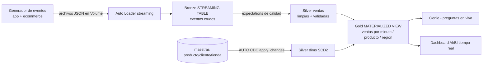

# Ejercicio 2 — Pipeline de Streaming en tiempo real con Delta Live Tables

### Structured Streaming · DLT declarativo · Expectations · SCD2 · Agregaciones en vivo

> **Stack:** Databricks Free Edition · Delta Live Tables (Lakeflow) · Structured Streaming · Auto Loader · Unity Catalog · AI/BI Genie
> **Construido con:** Claude Code + AI Dev Kit
> **Nivel:** Semi-senior (Data Engineer) · **Tiempo:** ~3 h · **Corre en Databricks Free Edition**
> **Continuación del Ejercicio 1** (Tambo Andino): ahí hiciste el batch diario; acá hacés el **tiempo real**.

---

## 1. Contexto de negocio

### 1.1 La necesidad

**Tambo Andino** ya tiene su pipeline batch (Ejercicio 1) que corre 1 vez al día. Pero el negocio necesita **ver las ventas a medida que ocurren**: detectar quiebres de stock en vivo, monitorear el ticket promedio del día y reaccionar en minutos, no al día siguiente.

> ⚠️ **El batch no alcanza para todo.** Cuando el negocio pide *"¿cuánto vendí en la última hora?"*, necesitás **streaming**. Saber cuándo usar batch vs streaming es una de las preguntas más comunes en entrevistas de Data Engineer.

### 1.2 Objetivo

Construir un **pipeline de streaming declarativo con Delta Live Tables (DLT)** que:

- Ingeste eventos de venta **en tiempo real** desde los canales digitales (app + e-commerce).
- Aplique **calidad de datos en vuelo** (expectations) sin frenar el stream.
- Mantenga dimensiones actualizadas con **SCD Type 2** automático (`AUTO CDC` / `apply_changes`).
- Genere **agregaciones business-ready** en vivo (ventas por minuto, por producto, por región).
- Exponga todo en **Genie** para preguntas en tiempo real.

### 1.3 Batch vs Streaming — cuándo cada uno

| | Batch (Ejercicio 1) | Streaming (este) |
|---|---|---|
| Latencia | Horas (1 corrida/día) | Segundos / minutos |
| Caso de uso | Reportes históricos, cierres | Monitoreo en vivo, alertas |
| Mecanismo | `trigger(availableNow)` | `trigger(processingTime)` / continuous |
| Costo | Bajo (corre y para) | Más alto (corre siempre) |

---

## 2. Arquitectura del proyecto

### 2.1 Diagrama de la pipeline DLT



### 2.2 Decisiones de diseño

| Decisión | Tecnología | Justificación |
|---|---|---|
| Framework de pipeline | **Delta Live Tables (DLT)** | Declarativo: definís las tablas, DLT gestiona dependencias, retries y calidad |
| Ingesta | **Auto Loader** en modo streaming | Detecta archivos nuevos y los procesa en cuanto llegan |
| Tablas de ingesta/transformación | **STREAMING TABLE** | Procesan solo lo nuevo (incremental), no reprocesan todo |
| Calidad | **DLT Expectations** (`@dlt.expect`) | Validan en vuelo; podés advertir, descartar o frenar |
| Dimensiones | **AUTO CDC** (`create_auto_cdc_flow`) | SCD Type 2 automático sin escribir el MERGE a mano |
| Agregaciones Gold | **MATERIALIZED VIEW** | Se recalculan eficientemente al llegar datos nuevos |
| Ventanas temporales | **Watermark** | Maneja datos que llegan tarde sin acumular estado infinito |

---

## 3. Setup del entorno

1. **Databricks Free Edition** (la misma cuenta del Ejercicio 1).
2. En el repo, crear la carpeta `dlt/` con los notebooks de la pipeline.
3. Crear el catálogo y schemas (reutilizamos `tambo_andino`, schema nuevo para streaming):

```sql
USE CATALOG tambo_andino;
CREATE SCHEMA IF NOT EXISTS streaming;
CREATE VOLUME IF NOT EXISTS streaming.landing;     -- aquí caen los eventos
```

---

## 4. Generador de eventos en streaming

Simula la app y el e-commerce escribiendo archivos de eventos al Volume cada pocos segundos. Corré este notebook en paralelo a la pipeline DLT.

`dlt/00_event_generator.py`:

```python
import time, json, random, datetime
CATALOG="tambo_andino"; LAND=f"/Volumes/{CATALOG}/streaming/landing/eventos"

productos = ["PROD-01","PROD-02","PROD-03","PROD-04","PROD-05"]
tiendas   = ["T01","T02","T03","T04"]
precio    = {"PROD-01":18.5,"PROD-02":24.9,"PROD-03":21.0,"PROD-04":19.9,"PROD-05":15.0}

def lote(n):
    ahora = datetime.datetime.now().isoformat()
    return [{
        "id_venta": f"EVT-{int(time.time()*1000)}-{i}",
        "ts": ahora,
        "canal": random.choice(["APP","ECOMMERCE"]),
        "codigo_producto": (p:=random.choice(productos)),
        "cantidad": (c:=random.randint(1,4)),
        "importe": round(precio[p]*c, 2),
        "id_cliente": f"C{random.randint(1,200):04d}",
        "id_tienda": random.choice(tiendas),
    } for i in range(n)]

# escribir ~20 lotes (en el taller, dejarlo corriendo unos minutos)
for b in range(20):
    df = spark.createDataFrame(lote(random.randint(5,15)))
    df.coalesce(1).write.mode("append").json(LAND)
    time.sleep(5)
print("eventos generados en", LAND)
```

---

## 5. Bronze — ingesta streaming (DLT)

> ℹ️ En DLT, una **STREAMING TABLE** lee solo los datos nuevos. Auto Loader detecta cada archivo que aparece y lo ingesta sin reprocesar lo anterior.

`dlt/01_bronze.py`:

```python
import dlt
from pyspark.sql import functions as F

@dlt.table(
    name="bronze_eventos",
    comment="Eventos de venta crudos, ingestados en streaming desde el Volume",
    table_properties={"quality": "bronze"})
def bronze_eventos():
    return (spark.readStream.format("cloudFiles")
        .option("cloudFiles.format", "json")
        .option("cloudFiles.inferColumnTypes", "true")
        .load(f"/Volumes/tambo_andino/streaming/landing/eventos")
        .withColumn("_ingest_ts", F.current_timestamp())
        .withColumn("_source_file", F.col("_metadata.file_path")))
```

---

## 6. Silver — calidad en vuelo + dimensiones SCD2

### 6.1 Ventas validadas con Expectations

> ⭐ **DLT Expectations** validan cada fila en streaming. Tres modos: `expect` (advierte), `expect_or_drop` (descarta la fila mala), `expect_or_fail` (frena la pipeline). Esto es calidad de datos **sin frenar el stream**.

`dlt/02_silver_ventas.py`:

```python
import dlt
from pyspark.sql import functions as F

@dlt.table(name="silver_ventas", comment="Ventas limpias y validadas")
@dlt.expect_or_drop("importe_valido", "importe > 0")
@dlt.expect_or_drop("cantidad_valida", "cantidad > 0")
@dlt.expect("producto_conocido", "codigo_producto IS NOT NULL")
def silver_ventas():
    return (dlt.read_stream("bronze_eventos")
        .select(
            "id_venta",
            F.to_timestamp("ts").alias("ts"),
            "canal", "codigo_producto", "cantidad",
            F.col("importe").cast("double"), "id_cliente", "id_tienda"))
```

### 6.2 Dimensión cliente con SCD Type 2 automático

`dlt/03_silver_dim_cliente.py`:

```python
import dlt

# tabla de streaming que recibe los cambios de la maestra de clientes
dlt.create_streaming_table("silver_dim_cliente")

dlt.create_auto_cdc_flow(
    target = "silver_dim_cliente",
    source = "bronze_cliente_cdc",     # stream de cambios de la maestra
    keys = ["id_cliente"],
    sequence_by = "fecha_actualizacion",
    stored_as_scd_type = 2)            # <- SCD2 automático, sin MERGE manual
```

> 🧠 `create_auto_cdc_flow` (antes `apply_changes`) gestiona el SCD2 por vos: detecta cambios, cierra versiones viejas e inserta nuevas. Esto es lo que en el Ejercicio 1 escribiste a mano con `MERGE`.

---

## 7. Gold — agregaciones en vivo

`dlt/04_gold.py`:

```python
import dlt
from pyspark.sql import functions as F

@dlt.table(name="gold_ventas_por_minuto", comment="Ventas agregadas por minuto (con watermark)")
def gold_ventas_por_minuto():
    return (dlt.read_stream("silver_ventas")
        .withWatermark("ts", "10 minutes")          # tolera datos tardíos hasta 10 min
        .groupBy(F.window("ts", "1 minute"), "canal")
        .agg(F.sum("importe").alias("venta_total"),
             F.count("*").alias("n_ventas"),
             F.sum("cantidad").alias("unidades")))

@dlt.table(name="gold_top_productos", comment="Ranking de productos en vivo")
def gold_top_productos():
    return (dlt.read("silver_ventas")
        .groupBy("codigo_producto")
        .agg(F.sum("importe").alias("venta"), F.sum("cantidad").alias("unidades"))
        .orderBy(F.desc("venta")))
```

> 🧠 **Watermark:** sin él, el stream guardaría estado infinito esperando datos tardíos. `withWatermark("ts","10 minutes")` le dice a Spark: *"después de 10 minutos, cerrá la ventana y descartá lo que llegue más tarde"*. Pregunta clásica de entrevista de streaming.

---

## 8. Conceptos de streaming que evalúan en entrevistas

| Concepto | Qué es | Dónde aparece |
|---|---|---|
| Structured Streaming | Motor de streaming de Spark con la API de DataFrames | Toda la pipeline |
| STREAMING TABLE | Tabla DLT que procesa solo lo nuevo | Bronze, Silver |
| Watermark | Límite de tolerancia a datos tardíos | Gold por minuto |
| Checkpointing | DLT lo gestiona solo (estado + offsets) | Automático en DLT |
| Exactly-once | Garantía de no duplicar ni perder | Delta + checkpoints |
| Stream-static join | Unir un stream con una tabla estática (dim) | Silver + dims |
| Expectations | Calidad declarativa en vuelo | Silver |
| AUTO CDC (apply_changes) | SCD2 automático sobre un stream | dim_cliente |
| Trigger continuous vs processingTime | Siempre-corriendo vs micro-batch cada N | Configuración de la pipeline |

---

## 9. Optimización en streaming

```sql
-- Liquid Clustering: clustering adaptativo, ideal para tablas que crecen por streaming
ALTER TABLE tambo_andino.streaming.gold_ventas_por_minuto CLUSTER BY (canal);

-- DLT corre OPTIMIZE/VACUUM automáticamente si activás Predictive Optimization;
-- si no, programá un mantenimiento periódico:
OPTIMIZE tambo_andino.streaming.silver_ventas;
VACUUM   tambo_andino.streaming.silver_ventas;
```

> 💡 En streaming se generan **muchos archivos chicos** (un micro-batch = varios archivos). Compactarlos con `OPTIMIZE` / Liquid Clustering es clave para que las lecturas no se degraden. Es exactamente el problema del deep-dive de optimización del catálogo.

---

## 10. Ejecutar la pipeline + Genie

### 10.1 Crear la pipeline DLT

UI: **Workflows → Delta Live Tables → Create Pipeline**:
- Source: la carpeta `dlt/`.
- Target catalog: `tambo_andino`, schema: `streaming`.
- Modo: **Triggered** (corre, procesa lo disponible y para — barato para el taller) o **Continuous** (siempre corriendo).
- Correr el generador (`00_event_generator.py`) en paralelo y ver el grafo DLT poblarse en vivo.

### 10.2 Genie sobre el Gold en vivo

Crear un Genie Space con `gold_ventas_por_minuto` + `gold_top_productos` y preguntar:
- *"¿Cuánto vendimos en los últimos 5 minutos por canal?"*
- *"¿Cuál es el producto más vendido ahora mismo?"*

---

## 11. Versionado y despliegue

Igual que el Ejercicio 1, la pipeline DLT se versiona y despliega con **Asset Bundles**:

```yaml
resources:
  pipelines:
    tambo_streaming:
      name: "Tambo Andino - Streaming DLT"
      catalog: tambo_andino
      target: streaming
      libraries:
        - notebook: { path: ./dlt/01_bronze.py }
        - notebook: { path: ./dlt/02_silver_ventas.py }
        - notebook: { path: ./dlt/03_silver_dim_cliente.py }
        - notebook: { path: ./dlt/04_gold.py }
      continuous: false
```

```bash
databricks bundle deploy -t dev
git add -A && git commit -m "feat: pipeline streaming DLT Tambo Andino" && git push
```

---

## 12. Conceptos aplicados + portafolio

| Concepto | Cómo se aplica |
|---|---|
| Delta Live Tables | Pipeline declarativa Bronze→Silver→Gold |
| Structured Streaming | Ingesta y agregaciones en tiempo real |
| Auto Loader | Detección incremental de eventos |
| Expectations | Calidad de datos en vuelo |
| SCD Type 2 automático | `create_auto_cdc_flow` sobre dim_cliente |
| Watermark + ventanas | Agregación por minuto tolerante a datos tardíos |
| Materialized Views | Gold recalculado eficientemente |
| Liquid Clustering | Optimización de tablas de streaming |
| Genie | Analítica en lenguaje natural en vivo |

**Cómo presentarlo:**
> *"Pipeline de streaming en Databricks con Delta Live Tables: ingesta de eventos en tiempo real con Auto Loader, calidad con expectations, dimensiones SCD2 automáticas con AUTO CDC, agregaciones con watermark, y analítica en vivo con Genie. Orquestado como pipeline DLT y desplegado con Asset Bundles."*

> 🎯 **Ejercicios 1 + 2 juntos** demuestran que dominás **batch Y streaming** sobre el mismo negocio — exactamente el perfil que buscan las vacantes Databricks. Ese es tu portafolio.
